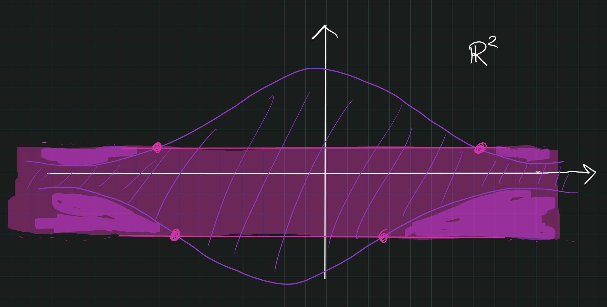

# Point-set topology

## Continuous images

[[PR-ZCUXL]]

## Metric spaces and analysis

[[T-7DICT]]

[[T-PRQ7I]]

[[T-O4UD3]]

[[C-EBAGE]]

::: {.example title="A uniformly continuous function that is not Lipschitz"}
$f(x) = \sqrt x$ on $[0, 1]$ is uniformly continuous, being continuous on a compact set, and is not Lipschitz, since $\abs{f(x)-f(0)}/\abs{x-0} = 1/\sqrt x$ is unbounded as $x\to 0^+$.

:::

[[T-OPK3N]]

[[T-PCL4H]]

[[T-HH3YP]]

[[FT-6WPJI]]

## Compactness

[[T-3FJK4]]

[[T-UEXBK]]

[[T-TJBYR]]

[[T-JFADP]]

## Retracts

[[PR-O7535]]

## Separation axioms

::: {.remark}
Recall that a [[D-ZFRV4|Hausdorff space]] is one in which distinct points have disjoint open neighborhoods, and a [[D-YEQC3|normal]] space is one in which disjoint closed sets have disjoint open neighborhoods.

:::

[[PR-R72XL]]

[[FT-52GNK]]

## Maps and homeomorphisms

::: {.example title="Retractions onto points"}
For every $x_0 \in X$, the constant map $r\colon X \to \theset{x_0}$ is a [[D-NCLVD|retraction]] onto $\theset{x_0}$.

:::

[[T-JSXGR]]

[[T-FA6VI]]

[[T-N6PYS]]

## The tube lemma

[[T-G4GO4]]

::: {.example title="The tube lemma fails without compactness"}
In $\RR\cross\RR$, the open set $N\coloneqq\theset{(x,y) \suchthat \abs y < e^{-x^2}}$ contains the slice $\RR\cross\theset{0}$, and it contains no tube $\RR\cross(-\delta,\delta)$ with $\delta>0$, since $e^{-x^2}<\delta$ for large $\abs x$.
Here the slice is taken in the noncompact factor $\RR$.

:::

## Subsets of the real line

[[PR-VGX2B]]

## Exercises

[[E-OYP3Y]]
