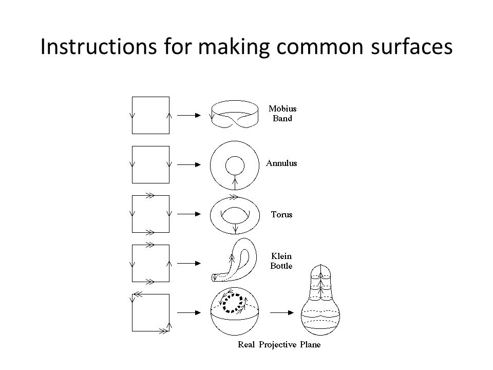

# Classification of surfaces

The classification of closed surfaces, the Euler characteristic, connected sums, and polygon models.

::: {.example title="Standard surfaces"}
\envlist

- the sphere $S^2$ [[D-SPHER|spheres and discs]];

- the torus $T^2 = S^1\cross S^1$ [[D-TORUS|torus]];

- the real projective plane $\RP^2$ [[D-RPROJ|real projective space]];

- the Klein bottle $\KK$;

- the Möbius band $\mobiusband$;

- the closed orientable surface of genus $g$, $\Sigma_g$, the [[D-CSUMM|connected sum]] of $g$ copies of $T^2$.

The Möbius band, the annulus $S^1\cross I$, $T^2$, $\KK$, and $\RP^2$ are quotients of a square by the edge identifications in these pasting diagrams:

:::

## The classification

### The classification theorem

[[T-NBARV]]

::: {.remark}
A polygon model computes the orientability, $b$ and $\chi$ of a surface: the edge word of a polygon with identifications reduces to a normal form $a_1b_1\inverseof{a_1} \inverseof{b_1}\cdots a_gb_g\inverseof{a_g} \inverseof{b_g}$ or $a_1a_1\cdots a_ka_k$, together with the unpaired boundary edges.
For example, the torus and the annulus both have Euler characteristic $0$ and are not homeomorphic, since $b=0$ for the torus and $b=2$ for the annulus.

:::

[[FF-D5Q4S]] [[FF-WDTKX]]

[[PR-JL5JP]]

### Euler characteristic

[[FF-W3AIU]]

[[D-SURFCH]]

[[FF-23V5J]]

[[FF-SM63J]]

[[FF-BOIT5]]

[[PR-QV4U5]]

[[C-CT2NX]]

### Connected sums and polygon decompositions

[[PR-GKRFP]]

[[PR-LIXWH]]

[[PR-BDH3V]]

